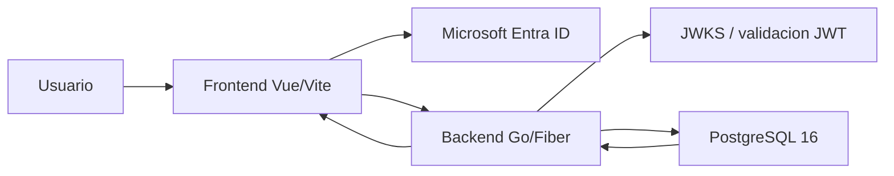
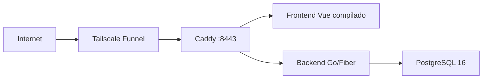
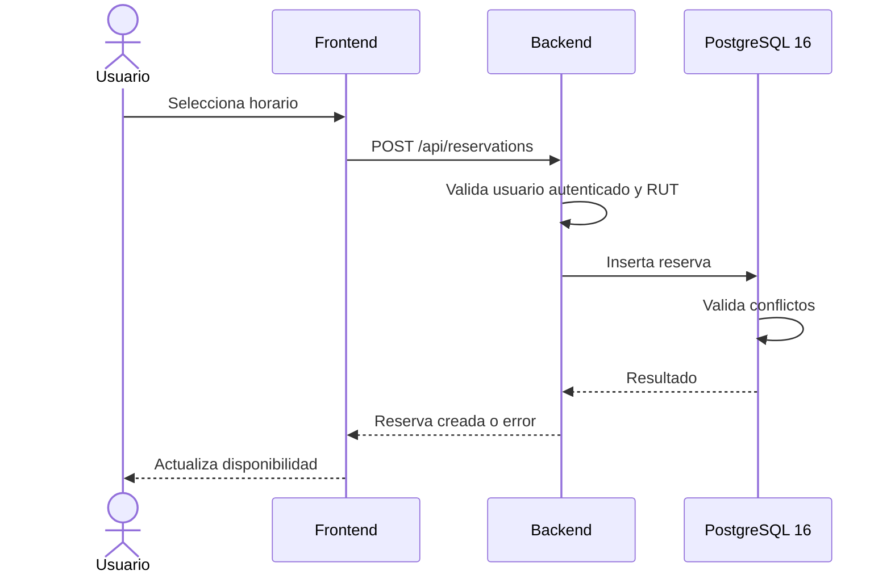

# Poli-REDI - Arquitectura

## Objetivo

Este documento resume la arquitectura vigente de Poli-REDI y el flujo principal entre frontend, backend, autenticacion y base de datos.

Corte documental: 2026-10-27. Referencia de validacion: cierre tecnico MVP3 del 2026-10-24, registrado en `docs/mvp3/cierre-mvp3-prototipo.md`. El cierre corresponde al prototipo, no a produccion institucional.

## Vista general

Vista de despliegue vigente:

## Frontend

El frontend vive en `frontend/` y usa:

- Vue 3.
- Vite.
- Pinia.
- Vue Router.
- Axios.
- MSAL Browser.

Responsabilidades principales:

- Autenticar al usuario con Microsoft Entra ID o modo local de desarrollo.
- Proteger rutas publicas, autenticadas y administrativas.
- Consultar recursos, actividades, reservas, talleres, notificaciones y usuario actual.
- Mostrar disponibilidad, reservas grupales, historial y talleres deportivos, junto con los modulos administrativos MVP3 de usuarios, sedes, recursos, bloqueos, programacion institucional, conflictos, politicas y reportes.
- Mostrar imagenes configurables de recursos y permitir su actualizacion a administradores.
- Enviar reservas sin confiar en IDs de usuario definidos en cliente.
- Consumir disponibilidad desde el endpoint sanitizado que integra reservas, actividades institucionales y bloqueos. La interfaz tambien presenta los talleres y las reglas correspondientes al modo del recurso.

## Backend

El backend vive en `backend/` y usa Go/Fiber.

Estructura principal:

- `cmd/`: arranque de la API.
- `internal/routes/`: registro de rutas.
- `internal/middleware/`: autenticacion, modo local y usuario actual.
- `internal/handlers/`: entrada HTTP.
- `internal/services/`: reglas de negocio.
- `internal/repositories/`: consultas, transacciones y persistencia mediante PostgreSQL 16. El backend compilable no utiliza consultas T-SQL; EV-011 se conserva como antecedente de migracion.
- `internal/models/`: modelos de datos.
- `internal/validators/`: validadores reutilizables.

Responsabilidades principales:

- Validar tokens Bearer de Microsoft Entra ID.
- Resolver o crear usuario local autenticado.
- Aplicar permisos de usuario normal y administrador.
- Crear y cancelar reservas usando el usuario autenticado.
- Listar talleres activos e inscribir al usuario autenticado cuando tenga RUT.
- Administrar usuarios, accesos y roles con auditoria; crear y mantener sedes y recursos, incluidos sus datos e imagenes; administrar bloqueos, programacion institucional, resolucion de conflictos y politicas versionadas mediante rutas protegidas.
- Exponer disponibilidad sanitizada para usuarios normales y detalle completo de reservas solo a administradores.
- Validar que reservas no se crucen con talleres activos asociados al mismo recurso.
- Validar RUT obligatorio para usuarios normales.
- Exponer datos desde PostgreSQL 16.

## Base de datos

La base vigente es PostgreSQL 16. Los scripts y modulos SQL Server/Azure SQL se conservan temporalmente como legado de EV-011 y no representan la arquitectura objetivo.

Estructura canonica vigente:

- `database/postgres/bootstrap/`: configuracion inicial de roles.
- `database/postgres/migrations/`: cadena `PG16_0001` a `PG16_0015`.
- `database/postgres/seed/`: datos iniciales de desarrollo.
- `database/postgres/check/`: verificaciones SQL disponibles.

Los scripts `database/schema.sql`, `database/seed.sql` y `database/drop.sql` pertenecen a la etapa historica SQL Server/Azure SQL y no deben utilizarse para inicializar PostgreSQL.

**Limitacion de instalacion:** `infra/local/quadlet/install.sh` copia las migraciones hasta `PG16_0010`. No constituye por si solo un bootstrap completo de MVP3. Las migraciones `PG16_0011` a `PG16_0015` requieren un procedimiento controlado y verificable; no se deben aplicar automaticamente sobre una base existente sin respaldo y revision.

La base aplica reglas criticas mediante constraints, indices, triggers y vistas:

- Usuarios, recursos, actividades, reservas, talleres e inscripciones.
- Imagen opcional por recurso mediante `resources.image_url`.
- Validacion basica de RUT.
- Conflictos de reserva por recurso y usuario.
- Recursos de uso libre (`OPEN_USE`) que permiten concurrencia y se visualizan como intensidad de uso.
- Control de cupos e inscripcion unica por usuario en talleres.
- Bloqueos y actividades institucionales implementados para el alcance MVP3.
- Notificaciones y auditoria.

## Autenticacion

Flujo real:

1. El usuario inicia sesion con Microsoft Entra ID.
2. El frontend obtiene token para la API.
3. El backend valida issuer, audience, firma y claims.
4. El backend busca o crea usuario local.
5. Las rutas protegidas usan el usuario local resuelto.

Flujo local:

1. `DEV_AUTH_ENABLED=true` habilita accesos locales.
2. El frontend envia headers `X-Dev-Auth-*`.
3. El backend crea o resuelve un usuario local de prueba.
4. Este modo no debe activarse en ambientes publicos.

## Flujo de reserva

## Despliegue

El despliegue vigente usa tres contenedores administrados como un stack:

- PostgreSQL 16 con volumen externo persistente.
- Backend Go/Fiber en Podman.
- Caddy sirviendo `frontend/dist` y actuando como proxy de `/api/*`.
- Podman Compose como unidad operativa.
- systemd de usuario para iniciar el stack al arrancar Debian.
- Tailscale Funnel publicando Caddy en HTTPS.

La definición operativa vive en el repositorio `poliredi-infra`. La antigua demo
en Azure Static Web Apps/App Service y Azure SQL es historia arquitectónica y no
representa el entorno desplegado actual.

## Arquitectura de politicas de reserva

Estado vigente: `ADMIN-006` CERRADO para el prototipo MVP3. La lectura, configuracion, comparacion, publicacion e historial administrativo de politicas versionadas utilizan PostgreSQL 16 y frontend Vue. La publicacion contempla idempotencia y control transaccional. La evidencia Azure SQL del 2026-07-21 permanece como antecedente historico, no como validacion del motor actual. Las correcciones excepcionales de reservas existentes permanecen pendientes.

- Las politicas de ventana, frecuencia, plazo, minimo, jornada, intervalo, duraciones y recursos permitidos se almacenan como versiones. La configuracion grupal por recurso y su minimo se implementaron en MVP2/MVP3 y forman parte de las versiones publicadas.
- Cada solicitud referencia la version vigente al crearse y conserva sus condiciones.
- La publicacion tiene vigencia inmediata. Una transaccion serializable cierra la version anterior, crea el snapshot completo y publica la nueva; en concurrencia, la transaccion que obtiene primero el bloqueo determina la version disponible para la reserva.
- Existe un bootstrap tecnico controlado: el esquema crea sus protecciones y, despues de cargar los recursos, el seed completa y marca una sola vez los recursos permitidos de la politica inicial heredada. No constituye una via administrativa para editar versiones publicadas.
- El solicitante se registra como participante, no puede retirar su participacion y debe cancelar la solicitud completa si desea abandonarla.
- Confirmar o retirar participacion, recalcular el estado y resolver el vencimiento forman una sola operacion transaccional por reserva.
- Los vencimientos se resuelven durante las operaciones relevantes de consulta y escritura. `ExpirePendingGroupReservations` cancela por `MINIMUM_NOT_MET` solamente reservas `PENDING` bajo el minimo. Una reserva previamente `CONFIRMED` que queda `AT_RISK` no se cancela por este proceso. La discrepancia con la formulacion general de RF-022 permanece registrada y pendiente de decision normativa. Un ejecutor programado queda como mejora futura si se requiere ejecucion puntual sin actividad del sistema.
- Una correccion excepcional permanece fuera de este incremento: el diseno aprobado exige seleccionar solicitudes futuras activas, previsualizar el efecto, declarar un motivo y aplicar el lote de forma atomica y auditada, sin editar versiones historicas ni cancelar implicitamente.
- `ADMIN-005` esta cerrado tecnicamente para el prototipo MVP3: programacion institucional, conflictos y resolucion administrativa implementados. `EV-010` conserva la ratificacion institucional pendiente de la regla de resolucion.

### Contratos implementados

Politicas de reserva:

- `GET /api/reservation-policy/current`: autenticado; devuelve condiciones operativas vigentes.
- `GET /api/admin/reservation-policies`: solo administrador en la superficie que lo habilita; devuelve historial completo.
- `POST /api/admin/reservation-policies`: publicacion administrativa versionada e idempotente en la superficie correspondiente.

Reservas grupales MVP 2:

- `GET /api/reservations/join/:code`: consulta progreso y condicion del grupo mediante codigo de invitacion.
- `POST /api/reservations/join/:code`: incorpora al usuario autenticado como participante.
- `DELETE /api/reservations/join/:code`: retira al usuario autenticado; el owner no puede abandonar de esta forma y debe cancelar la reserva.
- `GET /api/reservations/:id/participants`: lista participantes para owner o administrador.
- `POST /api/reservations/:id/join-code`: rota el codigo de invitacion para owner o administrador.

La identidad del participante proviene de la sesion autenticada y no de un `userId` enviado por el cliente.

### Contratos pendientes

Las correcciones excepcionales de politicas permanecen como diseño aprobado pero no deben presentarse como parte implementada del incremento:

- `POST /api/admin/reservation-policy-corrections/preview`: simular una correccion excepcional.
- `POST /api/admin/reservation-policy-corrections/apply`: aplicar una simulacion vigente con idempotencia por lote.

## Riesgos y mejoras recomendadas

- Mantener pruebas de regresion para `GET /api/availability/reservations`, que ya acepta `from` y `to` (rango maximo de 31 dias) y combina reservas, bloqueos y actividades institucionales. Los talleres se presentan segun su modelo funcional.
- Verificar en el ambiente integrado/online el contrato temporal PostgreSQL/API/frontend mediante `APP_TIMEZONE=America/Santiago` (`RES-009`). La estrategia `DATETIME2` queda como antecedente EV-011.
- Verificar desplegado que estado inicial y transiciones de reserva pertenecen exclusivamente al servidor (`RES-010`).
- Verificar desplegadas la jornada y las duraciones permitidas que ya aplica el backend (`RES-011`).
- Mantener y ampliar la cobertura existente de permisos, conflictos, reglas de reserva y persistencia PostgreSQL. Las suites automatizadas han sido ejecutadas durante el cierre MVP3; resta consolidar la ejecucion reproducible y la evidencia de calidad para MVP4 (`QA-001`).
- Agregar regresion frontend automatizada para router, formulario, recursos no reservables y helpers temporales (`QA-002`).
- Evitar detalles internos en respuestas HTTP y conservarlos solo en logs sanitizados (`SEC-005`).
- Mantener `RequireAdmin` para nuevas rutas administrativas y `DEV_AUTH_ENABLED=false` en despliegues publicos; ambas bases ya estan implementadas/documentadas.
